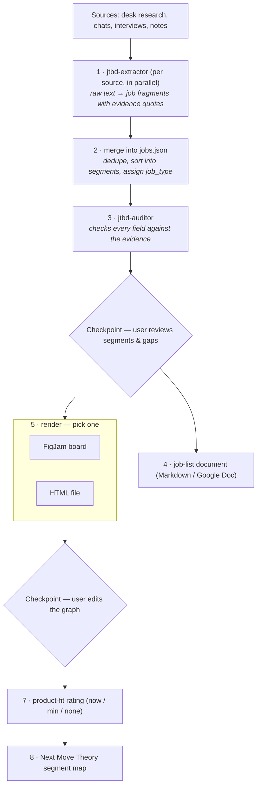

# JTBD Job Mapper — research to jobs, a graph and a segment map, for Claude Code

> Two Claude Code skills, one engine. Turn customer research into a Jobs-to-be-Done package — segments,
> a job list in **When / Want to / So that** form, a link graph, and a **Next Move Theory** segment map —
> built on the **Advanced Jobs To Be Done** canon by Ivan Zamesin (not generic Christensen JTBD).
> One renders it to a FigJam board. The other renders it to a single HTML file that needs no account
> and no internet connection.

🔗 **Live demo:** https://jtbd-job-mapper.dervlad.com
👤 **Author:** [Uladzislau Dziarkach (Vladislav Derkach)](https://www.linkedin.com/in/vladislavderkach/en/)

---

## What it is

You hand it research — desk research, a chat or interview corpus, call transcripts, notes — and it extracts
every customer job, sorts jobs into segments, links them into a graph (sequence, and which job is done for
the sake of which), rates how well your product covers each one, and draws a segment map. Every field is
either backed by a quote from the source, labeled as the research author's hypothesis, labeled
`[AI-ASSUMPTION]`, or left as a blank `—`. Nothing is invented.

Two skills share the exact same extraction, validation and auditing engine. They differ only in the
last step:

| | `/jtbd-research-to-figjam` | `/jtbd-research-to-html` |
|---|---|---|
| Output | a FigJam board | one self-contained HTML file |
| Needs | the Figma MCP, a Figma account | nothing but Python 3 and a browser |
| Editing the graph | drag cards by hand on the board, the skill reads your edits back | edit `jobs.json`, re-render in under a second |
| Collaboration | several people on one board | share the file, or print it to PDF |

Pick one, or install both and let the person you're talking to decide per request.

### It works for any research, any product

Nothing is hard-wired to a particular company or industry. The source of truth is one file,
`work/jobs.json`, that both skills read and write — segments, jobs, links, product-fit ratings. Everything
else (the Markdown export, the FigJam board, the HTML page) is a view generated from it.

---

## The pipeline



Full detail of every stage lives in each skill's own `SKILL.md`.

---

## The 2 sub-agents

| Agent | What it does |
|---|---|
| `jtbd-extractor` | Reads one research source, extracts every customer job it can find, returns a `jobs.json` fragment with evidence quotes. Run once per source, in parallel. |
| `jtbd-auditor` | Reviews the merged `work/jobs.json`: checks every field against the evidence, flags anything unsupported, catches Fake Job mislabels and missed Tax Jobs. |

Full source of both agents lives in [`files/agents/`](files/agents), the two skills in
[`files/skill-figjam/`](files/skill-figjam) and [`files/skill-html/`](files/skill-html).

---

## Install

### Option A — as a Claude Code plugin (recommended)

```
/plugin marketplace add VladislavDerkach/jtbd-job-mapper
/plugin install jtbd-job-mapper@jtbd-job-mapper
```

This installs both skills (`/jtbd-research-to-figjam`, `/jtbd-research-to-html`) and both sub-agents
(`jtbd-extractor`, `jtbd-auditor`). Update later with `/plugin update jtbd-job-mapper@jtbd-job-mapper`.

### Option B — one-line installer

```
curl -fsSL https://jtbd-job-mapper.dervlad.com/install.sh | bash
```

Downloads both skills and both agents straight into `~/.claude/`. Review [`install.sh`](install.sh)
before running it — it's three `curl` calls per file into your Claude config directory, nothing else.

### Option C — clone and install locally

```
git clone https://github.com/VladislavDerkach/jtbd-job-mapper.git
cd jtbd-job-mapper
./install-local.sh
```

Same result as Option B, copied from your local clone instead of downloaded.

After any option: restart Claude Code, then ask it to turn some research into a jobs board — it'll ask
whether you want FigJam or an HTML file.

---

## Example

[`files/skill-figjam/assets/jobs.example.json`](files/skill-figjam/assets/jobs.example.json) (identical
copy in the HTML skill) is a real worked example from the yachting-charter industry: two segments,
five jobs, three links, built on [HandoverBoat](https://handoverboat.com)'s own research. Run either
render script on it to see the output before you bring your own data:

```
python3 files/skill-html/scripts/render_html.py files/skill-html/assets/jobs.example.json /tmp/example.html --open
```

---

## License

MIT — see [`LICENSE`](LICENSE). Read the code before you run it against your own research.
